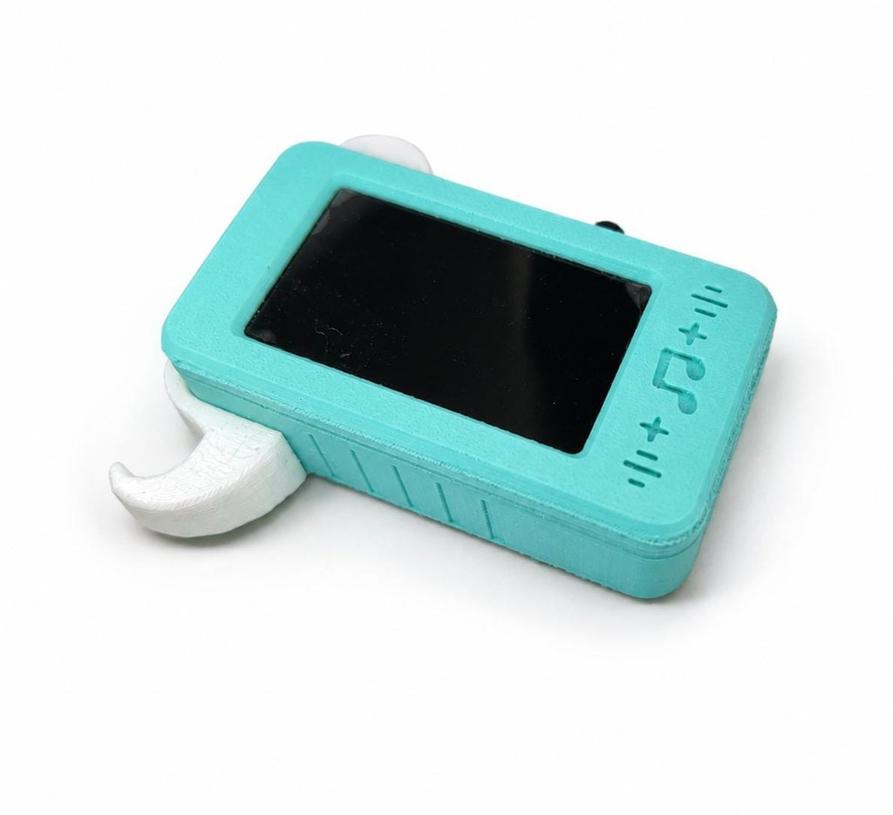
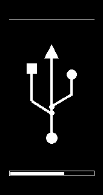

# SpookyPod — Handheld Haunted Sound & SFX Player

**Built for the element14 Community 2026 Halloween Hackathon ("Create, Scare, Win")**

SpookyPod is an ultra-compact, portable handheld sound effects and audio player designed for Halloween props, haunted house animatronics, electronic costumes, and trick-or-treater jump-scares. Powered by the Analog Devices MAX32655 microcontroller (Arm® Cortex®-M4F @ 100 MHz) and a MAX9867 low-power stereo audio codec, it delivers CD-quality audio playback from a MicroSD card while running a high-frame-rate pixel display and dynamic spooky visual themes.

---

## Background & Project Inspiration

For the element14 2026 Halloween Hackathon, the challenge was to create electronics that bring Halloween to life: spooky decorations, responsive costume accessories, or automated scare devices. Most off-the-shelf sound boards for props rely on low-fidelity 8-bit sound chips or bulky single-board computers with high boot times and heavy battery drain.

SpookyPod was engineered to bridge this gap:
- **Instant Boot:** Powers on in under 1.5 seconds, immediately ready to trigger eerie atmospheric loops or instant scream SFX.
- **Micro-Power Architecture:** Consumes minimal active power with a deep sleep draw under 15 µA, enabling days of standby on a small 3.7V LiPo cell.
- **Dedicated Audio Codec:** Hardware 16-bit 48 kHz stereo audio output via I2S DMA to the MAX9867 headphone amplifier, providing clean sound directly to headphones, costume-mounted speakers, or PA amplifiers.
- **Haunted Visuals:** An integrated 1.9-inch IPS display renders custom Halloween artwork, including a carved glowing Jack-o'-lantern boot splash, a spooky graveyard landscape (harvest moon, flying bats, silhouettes, tombstones), and animated gothic screensavers.

---

## Technical Specifications

- **Microcontroller:** Analog Devices MAX32655 (Arm Cortex-M4 with FPU @ 100 MHz, 512 KB Flash, 128 KB SRAM, BLE 5.2)
- **Audio Codec:** Analog Devices MAX9867 ultra-low-power stereo audio codec
- **Audio Transport:** 16-bit stereo PCM @ 48 kHz over I2S with ping-pong DMA buffers
- **Audio Decoders:** Real-time MP3 decoding (`minimp3`) and 16-bit uncompressed WAV parser
- **Display:** 1.9" IPS LCD (ST7789V2 controller, 170x320 portrait resolution) over high-speed SPI (30 MHz)
- **Storage:** MicroSD Card slot running FatFS (`ff15`) over SPI (up to 32 GB FAT32)
- **User Navigation:** 3-way navigation jog dial (Track Prev/Vol Up, Select/Settings, Track Next/Vol Down) and front tactile button
- **Power Management:** Analog Devices MAX20303 PMIC with dedicated 1.8V BUCK2 audio rail and battery fuel gauging
- **Sleep Modes:** Configurable screen timeout (5s, 10s, 30s) and deep sleep with instant GPIO wake (< 15 µA standby)
- **Form Factor:** Compact handheld 3D-printed enclosure designed for pocket carry or concealment within props

---

## Photos & Visuals

### Assembled Hardware

| Handheld Front View (Witch Theme) | Angled Profile (Custom Demon Horns & Jog Switch) |
| :---: | :---: |
|  |  |

The 3D-printed enclosure features custom snap-fit monster/demon horns for a distinctive Halloween prop look, a side cutout for the 3-way navigation jog dial, bottom USB-C port, and top audio jack output.

### Halloween UI & Pixel-Art Screensavers

| Element14 Hackathon Event | Spooky Witch Screensaver | USB Upload Mode Screen |
| :---: | :---: | :---: |
|  |  |  |

- **Boot Splash:** Jack-o'-lantern carved pumpkin with "ELEMENT14 HACKATHON 2026" badge.
- **Graveyard Landscape:** Dynamic hill silhouette, glowing amber harvest moon, flying bats, tombstones (`†`), and mini-pumpkins.
- **Animated Screensaver:** Gothic witch with glowing pumpkin lanterns and drifting particles.
- **USB Upload Screen:** Full-screen USB symbol activated whenever the device enters USB file transfer mode.

---

## Quick Start: 1-Click Flashing

A pre-compiled binary is provided so anyone can flash the firmware without having to install the full development toolchain.

### Requirements

1. Python 3.8 or newer with `pyserial` installed:
   ```bash
   pip install pyserial
   ```
2. OpenOCD (included with Maxim SDK, Zephyr SDK, or standalone).

### Flashing Steps

1. Connect the MAX32655 board to your PC via USB-C.
2. In the `tools/` folder, run:
   ```bash
   tools/flash_firmware.bat
   ```
   Or launch the cross-platform flasher directly:
   ```bash
   python tools/flash_firmware.py
   ```
3. The flasher automatically locates OpenOCD, connects via CMSIS-DAP, uploads the fast SRAM programming engine, programs the entire 347 KB firmware in approximately 12 seconds, and boots into the SpookyPod Halloween splash screen.

The ready-to-flash binaries are available for direct download:
- [`max32655.bin`](https://github.com/Sparkshiva007/SpookyPod-Halloween-Audio-Player/releases/download/v1.0.0/max32655.bin) (Main firmware binary)
- [`scratch_flasher.bin`](https://github.com/Sparkshiva007/SpookyPod-Halloween-Audio-Player/releases/download/v1.0.0/scratch_flasher.bin) (Fast SRAM flash loader)

---

## Building from Source

If you want to modify the firmware or build your own custom artwork:

### 1. Toolchain Setup

- **Analog Devices MSDK:** Download from the [Analog Devices MSDK Guide](https://analogdevicesinc.github.io/msdk/USERGUIDE/).
- **Compiler:** `arm-zephyr-eabi-gcc` or `arm-none-eabi-gcc` (provided by MSDK).
- **Make:** GNU Make.

### 2. Compilation

Navigate into the `firmware/` directory and run:

```bash
cd firmware
make -j4 TARGET=MAX32655 BOARD=FTHR_Apps_P1 MAXIM_PATH=C:/MaximSDK PREFIX=arm-zephyr-eabi
```

The compiled binary will be produced at `firmware/build/max32655.bin`.

### 3. Direct OpenOCD Programming

```bash
openocd -f interface/cmsis-dap.cfg -f target/max32655.cfg -c "init; reset halt; max32xxx mass_erase 0; program build/max32655.bin 0x10000000 verify reset exit"
```

---

## Managing Sound Effects & Music (Spooky Music Manager)

To load screams, ghost whispers, spooky soundtracks, or ambient audio onto the player, a custom desktop application is provided: `tools/spooky_manager.py`. A pre-built standalone Windows executable is available for direct download: [`Spooky_Music_Manager.exe`](https://github.com/Sparkshiva007/SpookyPod-Halloween-Audio-Player/releases/download/v1.0.0/Spooky_Music_Manager.exe) (or in the [v1.0.0 Release](https://github.com/Sparkshiva007/SpookyPod-Halloween-Audio-Player/releases/tag/v1.0.0)).

The companion tool supports two modes:

### Mode 1: Direct MicroSD Card Reader (Fastest)
1. Plug the MicroSD card into your PC's card slot or USB adapter.
2. The software automatically detects the card, reads the existing sound directory, and displays free storage.
3. Drag and drop audio files (`.mp3` or `.wav`) to transfer at up to 80 MB/s (< 0.2 seconds per song).

### Mode 2: In-Device USB Cable Mode
1. On the SpookyPod device, open the menu and select **USB Upload Mode** (the screen displays the USB symbol).
2. Connect the USB cable to your PC.
3. In `Spooky Music Manager`, select the COM port and click **Connect**.
4. Upload files directly over the serial data pipeline into the MicroSD card.
5. Once complete, click **Disconnect Device** to return to playback mode.

---

## Repository Structure

```
SpookyPod-Halloween-Audio-Player/
├── assets/                  # Photos, hackathon banner, screensavers, and UI graphics
│   ├── element14_hackathon_banner.jpg
│   ├── hardware_front.jpg
│   ├── hardware_side.jpg
│   ├── screensaver_halloween_witch.png
│   └── ui_usb_mode.png
├── bin/                     # Pre-compiled firmware binaries and ready-to-flash files
│   ├── max32655.bin
│   └── scratch_flasher.bin
├── firmware/                # Complete C firmware source code
│   ├── audio_player.c       # Audio streaming engine, minimp3, FatFS, and I2S DMA
│   ├── display.c            # ST7789 SPI driver, pumpkin art, landscape, and UI
│   ├── display.h            # Color definitions and display function prototypes
│   ├── halloween_art.h      # 170x320 pixel-art screensaver bitmap and palette
│   ├── main.c               # System initialization, interrupt handlers, and event loop
│   ├── Makefile             # GNU Make build configuration for ARM toolchain
│   ├── max9867.c            # MAX9867 audio codec I2C driver
│   ├── player_app.c         # State machine, jog dial navigation, and settings menus
│   └── sd_spi.c             # High-speed SPI driver for MicroSD FatFS interface
├── hardware/                # Schematics, pinout references, and bill of materials
│   ├── BOM.md               # Bill of Materials
│   └── PINOUT.md            # Complete MCU pinout mapping table
├── tools/                   # Flashing utilities and PC companion manager app
│   ├── flash_firmware.bat   # Windows 1-click batch flasher
│   ├── flash_firmware.py    # Python OpenOCD flash utility
│   └── spooky_manager.py    # PyQt6 Spooky Music Manager desktop app
├── LICENSE                  # MIT License
└── README.md                # Project documentation
```

---

## Author & License

- **Author:** Shivashankar P ([Sparkshiva007](https://github.com/Sparkshiva007))
- **Competition:** [element14 Community 2026 Halloween Hackathon ("Create, Scare, Win")](https://community.element14.com/)
- **License:** Released under the [MIT License](LICENSE).
